# ESP32 Webradio – Advanced Internet Radio with VS1053, TFT Display & Webinterface

[](https://platformio.org/)
[](https://opensource.org/licenses/MIT)

A fully‑featured, high‑performance Internet radio based on the **ESP32** dual‑core microcontroller, the **VS1053** hardware MP3/Ogg decoder and a colour TFT display.  
The firmware supports **multi‑tasking** (FreeRTOS), **fail‑safe startup**, **JSON REST API**, **rotary encoder** control, **alarm clock**, **sleep timer**, **WiFi scanning** and **OTA updates** – all managed through a modern, responsive web interface.

**Source code:** [github.com/joruf/esp32-webradio](https://github.com/joruf/esp32-webradio)

---


## Project Structure

```text
esp32-webradio/
├─ src/
│  ├─ main.cpp                     # Entry point, tasks, initialisation
│  ├─ boot/                        # Startup validation & radioSetup()
│  ├─ config/                      # firmware_config.h (display type, version)
│  ├─ globals/                     # Shared types and globals
│  ├─ handler/                     # Core modules
│  │  ├─ alarm.h / alarm_config.h  # Sleep timer & alarm scheduler
│  │  ├─ display.h                 # TFT text/battery/volume rendering
│  │  ├─ http.h / http_queue.h     # HTTP server, JSON API, SSE
│  │  ├─ radio_config.h            # Unified JSON configuration (NVS)
│  │  ├─ interface.h               # Command parser (analyzeCmd)
│  │  ├─ isr.h                     # Encoder interrupt handlers
│  │  ├─ mp3.h                     # Streaming loop, data parsing
│  │  ├─ nvs.h                     # NVS read/write functions
│  │  ├─ ota_check.h               # OTA manifest check
│  │  ├─ rotary_encoder.h          # Encoder state machine
│  │  ├─ setup.h                   # WiFi scanning, connection, AP mode
│  │  ├─ stream.h                  # Audio queue & playback task
│  │  ├─ time.h                    # NTP synchronisation
│  │  ├─ volume.h                  # Mute / volume management
│  │  └─ vs1053.h                  # VS1053 driver
│  ├─ web_assets/                  # Embedded web UI (PROGMEM)
│  │  ├─ pages/                    # HTML views (*_page.h → *_html)
│  │  ├─ styles/                   # CSS (app.css.h)
│  │  ├─ scripts/                  # JavaScript (app.js.h)
│  │  └─ web_assets.h              # Umbrella include
│  └─ display/                     # Display drivers
│     ├─ BlueTFT.h, ILI9341.h, ...
├─ ota/                            # version.json & release binaries (GitHub OTA)
├─ platformio.ini
├─ android-app/                  # Optional Android companion app (WebView)
└─ README.md
```

---

## Key Features

- **Hardware Audio Decoding** – VS1053 handles MP3 / Ogg / AAC / WAV streams, offloading the ESP32.
- **Multi‑Core Tasking** – Audio streaming runs on Core 0, network/UI tasks on Core 1 for smooth playback.
- **Auto‑Discovery WiFi** – Stores multiple SSID/password pairs; falls back to Access Point mode if no known network is found.
- **Rotary Encoder Control** –  
  - Turn → volume up/down  
  - Single click → toggle play/stop  
  - Double click → change station (preset selection)  
  - Long press / triple click (configurable)
- **Rich Web Interface** – Built with Bootstrap 3, jQuery and a JSON API.  
  - Real‑time metadata (station name, song title) via SSE (`/?events`) or polling  
  - Pages: Webradio, **MP3 Stream** (LAN playback from PC/phone), Scheduler, Configuration, Sound, Display, OTA Update, Maintenance, About, Diagnostics  
  - Volume, tone control (bass/treble gain & frequency)  
  - Preset management (add, edit, delete, drag-and-drop reorder)  
  - Snooze timer & alarm scheduler (weekdays, multiple alarms)
- **Alarm & Sleep Timer** – Wake‑up alarms on the **Scheduler** page; snooze timer on the index page (`/?snooze=XX`).
- **Automatic TFT Backlight Control** – Turns on when any interaction occurs, dims/powers off after 5 minutes of inactivity.
- **Playlist Support** – Handles `.m3u` playlists (remote streams).
- **Non‑Volatile Storage (NVS)** – All settings survive reboots (unified `radio_config` JSON plus legacy keys).
- **OTA Firmware Update** – Version check and install from the OTA page (GitHub manifest in `ota/`).
- **Multiple Display Types** – Supports ST7735, ST7789, ILI9341, SSD1306, LCD1602, NEXTION and a dummy (serial only) display – switchable in `firmware_config.h`.
- **Android Companion App** – Optional WebView app in `android-app/` to control the radio from your phone (same web UI, no firmware changes).

> **Current hardware setup:** SD card playback and IR remote are **not** used in the active firmware (`mountSDCard()` disabled in `app_setup.h`; `scanIR()` not called in `main.cpp`). Legacy code paths remain in the repository for optional future use.

---

## Web UI Screenshots

Captured from a live device at `http://192.168.178.33` (firmware `v2.33`) to document the current look and layout of each page.

### Main navigation pages

- **Webradio Dashboard** (`index.html`) – Live metadata, playback controls, stream input, preset list, and display toggles.  
  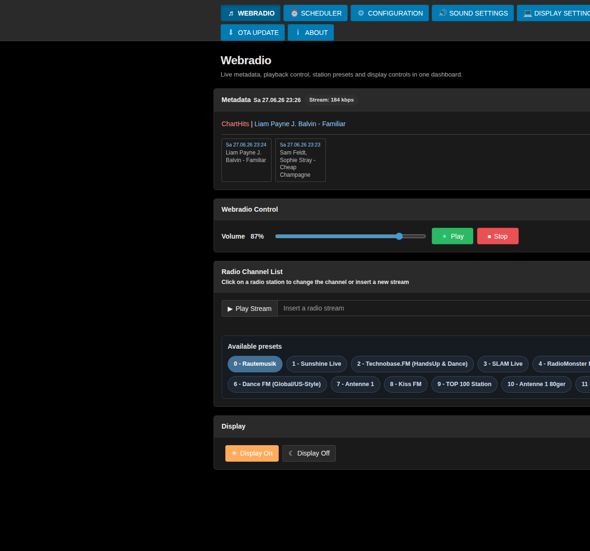
- **MP3 Stream** (`mp3stream.html`) – Stream MP3 files from your PC or phone over the local network (see [MP3 Stream – play your own music](#mp3-stream--play-your-own-music) below).  
  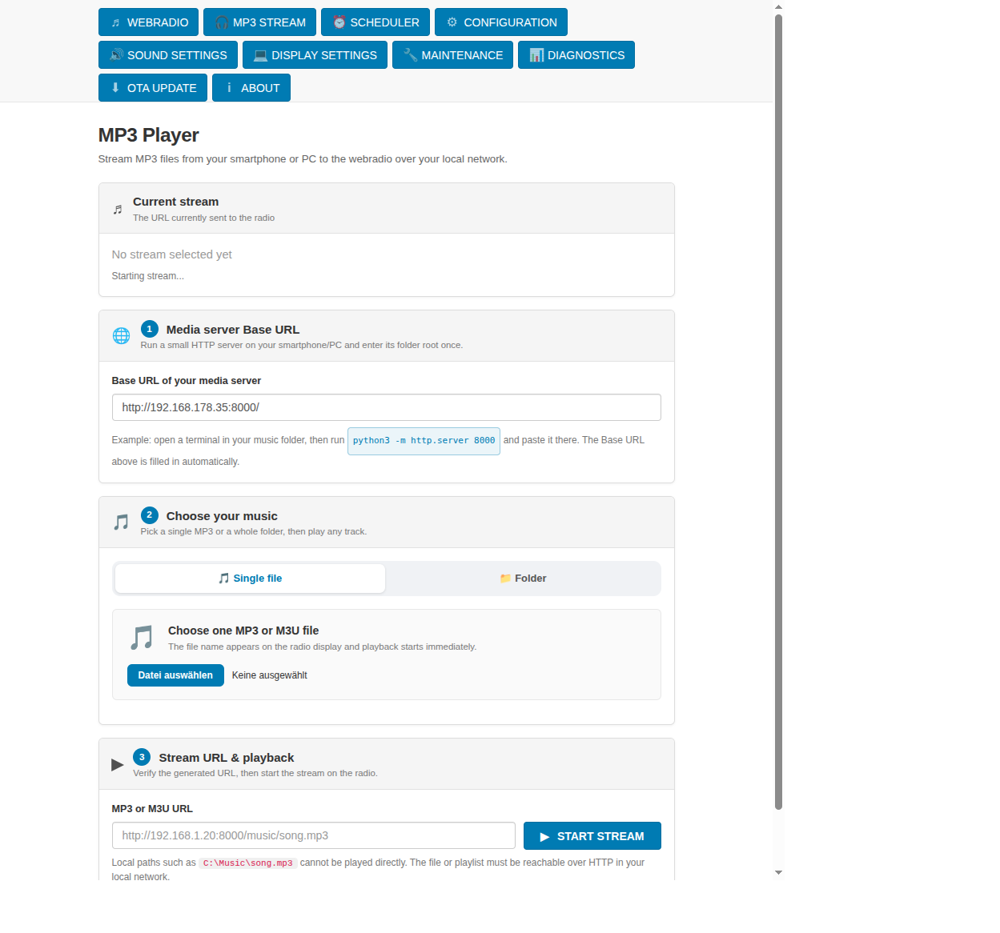
- **Scheduler** (`scheduler.html`) – Snooze timer and multi-alarm scheduling with weekday selection and fade duration.  
  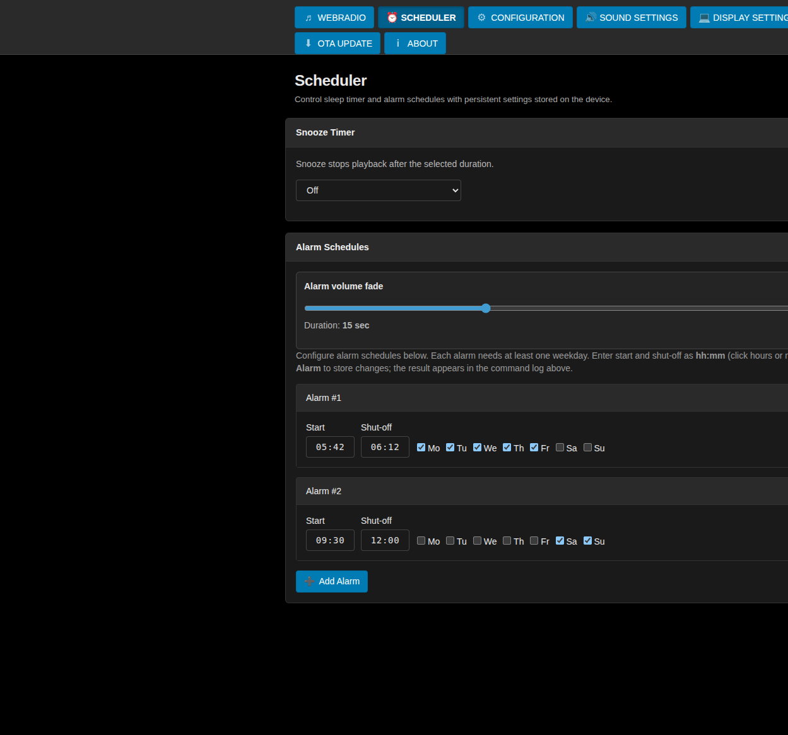
- **Configuration** (`config.html`) – WiFi priorities, clock settings, startup preset, watchdog option, presets, and GPIO mapping.  
  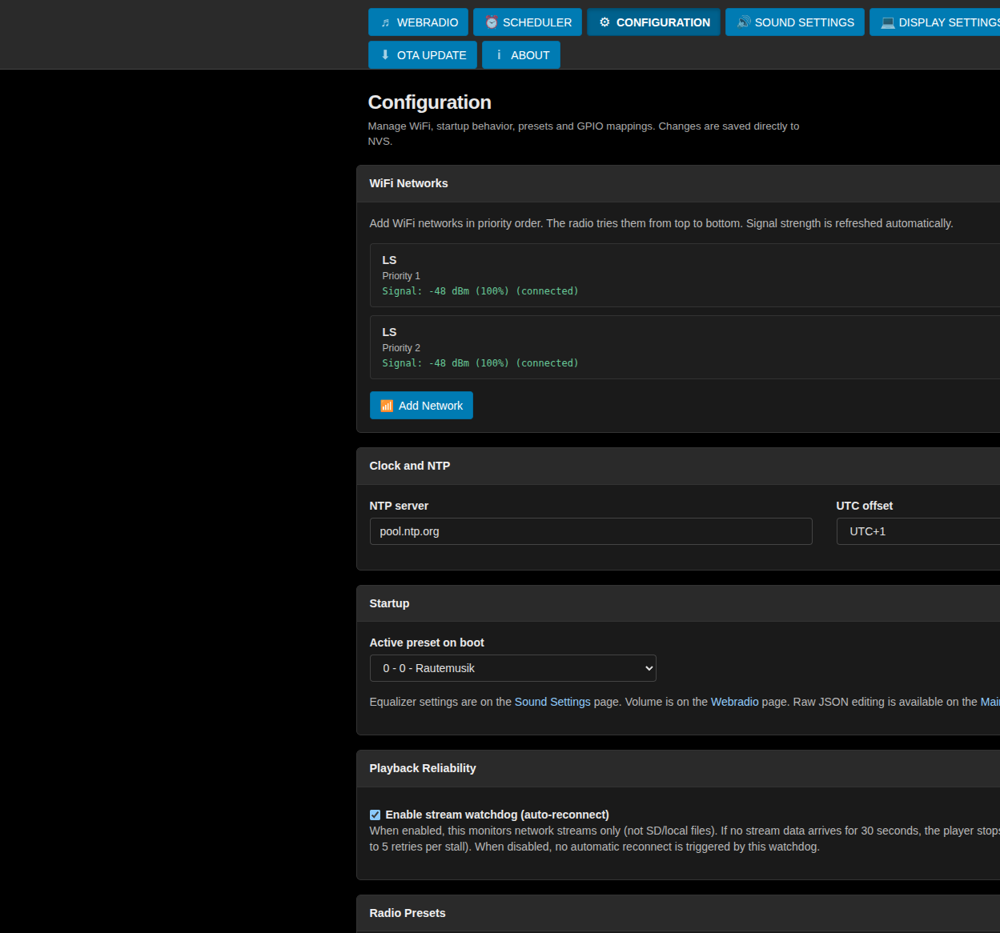
- **Sound Settings** (`sound.html`) – Master output level and VS1053 treble/bass equalizer controls.  
  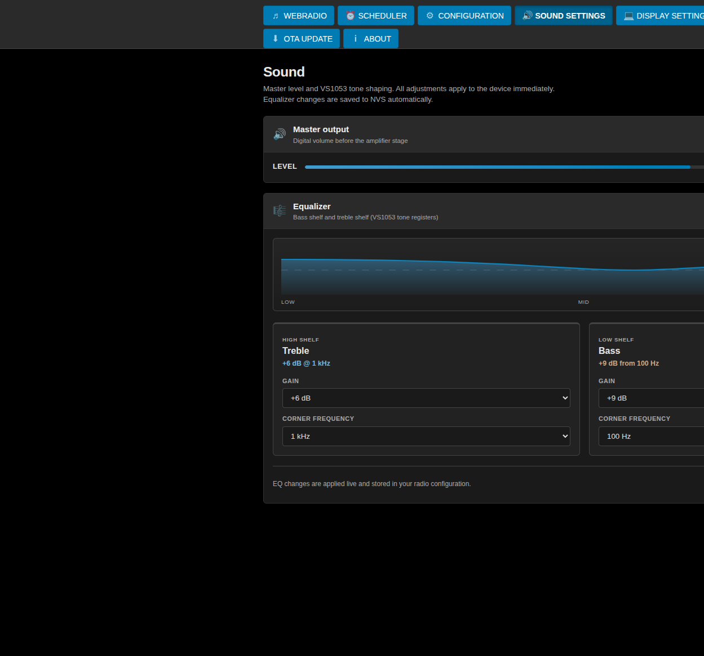
- **Display Settings** (`display.html`) – Dark mode schedule and TFT VU meter behavior toggles.  
  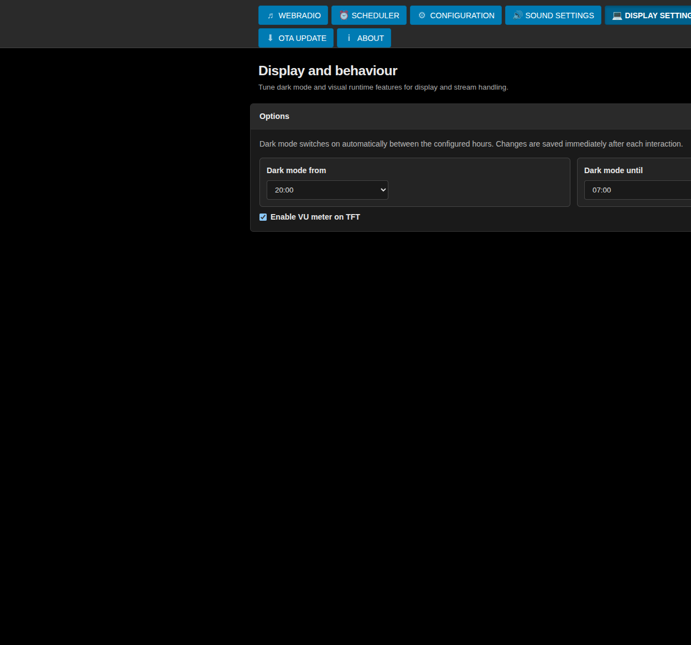
- **Maintenance** (`maintenance.html`) – Restart, erase storage, and raw JSON configuration editor.  
  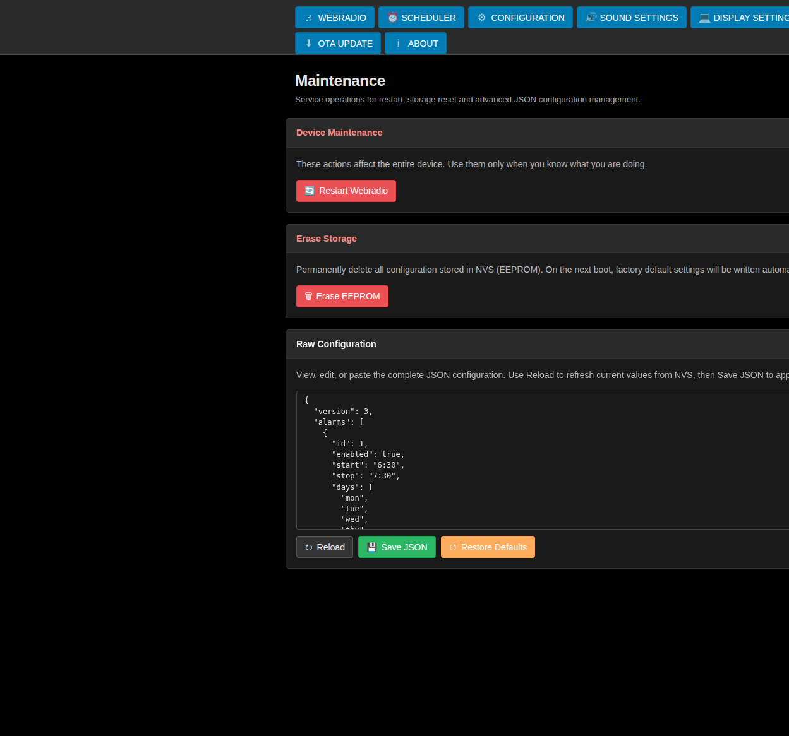
- **Diagnostics** (`diagnostics.html`) – Runtime/device JSON diagnostics and refresh control.  
  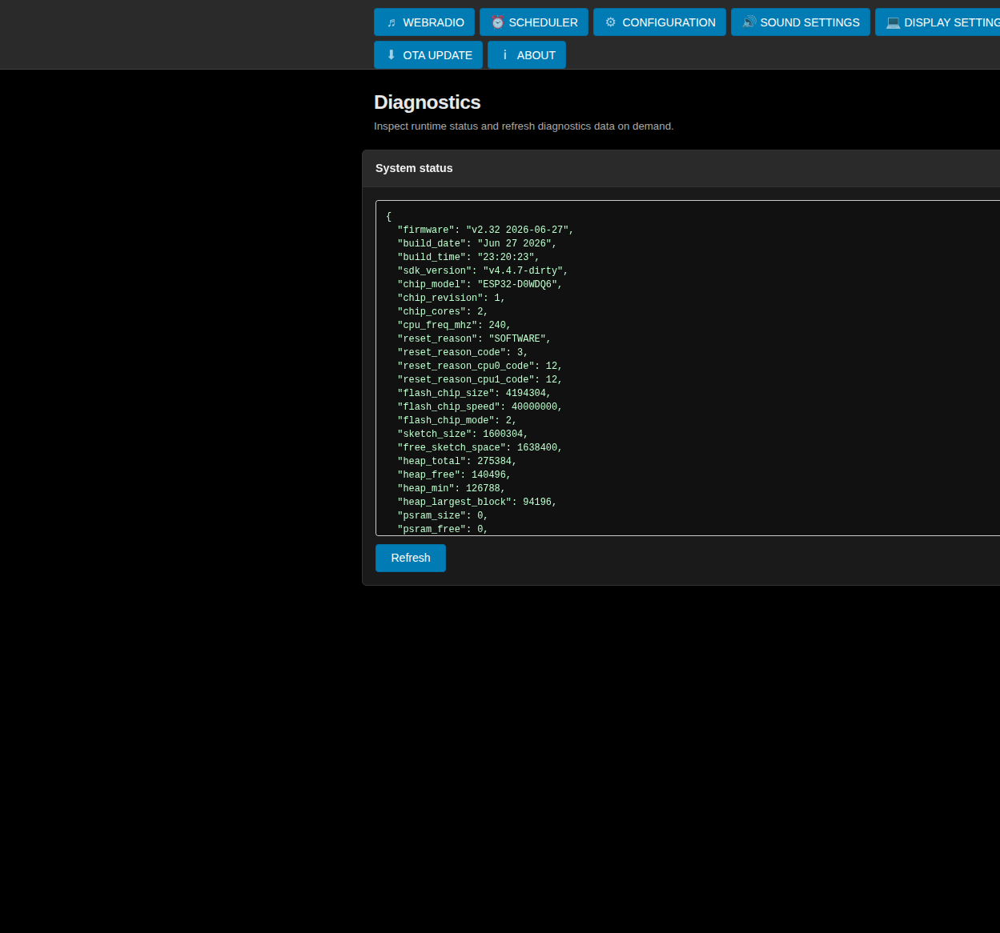
- **OTA Update** (`ota.html`) – Online update check/install, local `.bin` upload, release history, and manifest URL settings.  
  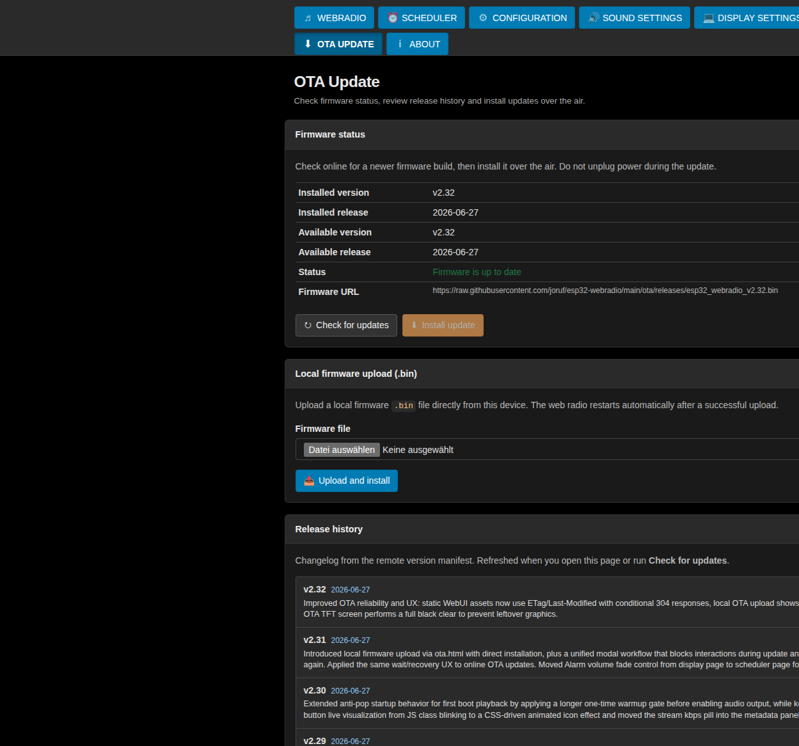
- **About** (`about.html`) – Project overview, feature summary, and source links.  
  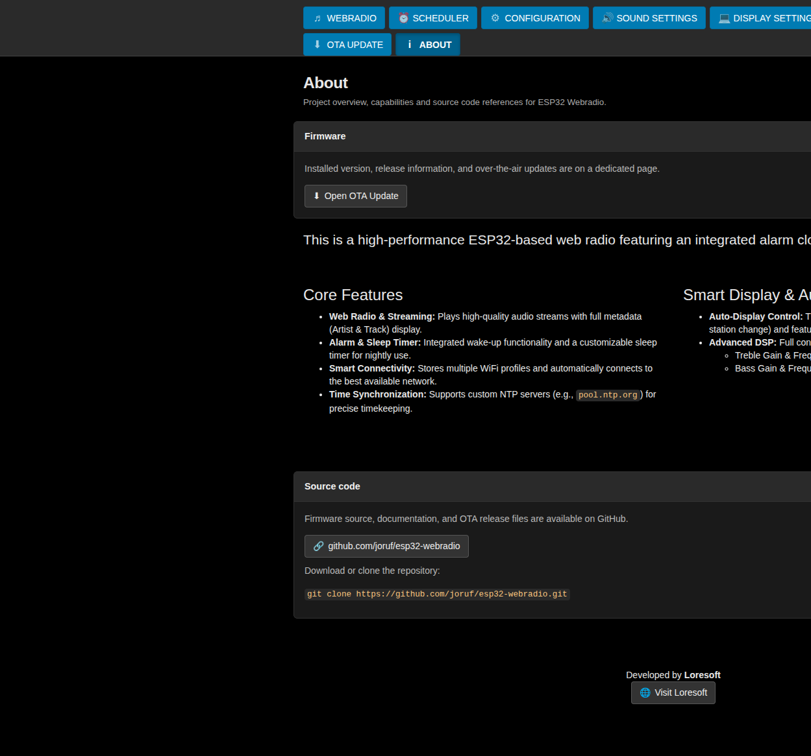

### Additional UI pages

- **Firmware Upgrade (legacy)** (`firmware.html`) – Legacy one-click firmware installer view.  
  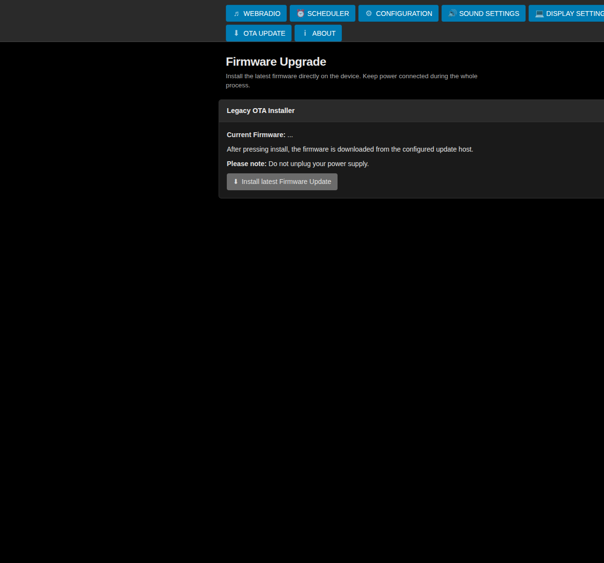

---

## MP3 Stream – play your own music

The **MP3 Stream** page (`mp3stream.html`) lets you play MP3 files that live on your **computer or smartphone** through the webradio speakers.  
The webradio does **not** read files directly from your hard drive. Instead, your PC/phone briefly acts as a small **music server**, and the ESP32 streams the file over your home Wi‑Fi — just like an internet radio station, but entirely on your local network.

### What you need

| Requirement | Why |
|-------------|-----|
| ESP32 webradio on your Wi‑Fi | Receives the stream and plays it through the VS1053 |
| PC, laptop, or phone on the **same Wi‑Fi** | Must reach the media server URL |
| MP3 files in one folder | e.g. `~/Music` or `~/Downloads` |
| **Python 3** on the device that serves the files (most Linux/macOS PCs; Windows with Python installed) | Runs the built-in mini web server |

> **Important:** Paths like `C:\Music\song.mp3` or files picked in the browser **cannot** be played directly. The file must be reachable as an **HTTP URL** (e.g. `http://192.168.178.35:8000/song.mp3`).

### Step-by-step (for beginners)

1. **Open the MP3 Stream page** in your browser: `http://<radio-ip>/mp3stream.html`  
   (Replace `<radio-ip>` with the address shown on the webradio display or in your router.)

2. **Prepare your music folder on the PC/phone** that will serve the files.  
   Example: put MP3s in `Downloads` or create a folder `Music`.

3. **Start a small web server** in that folder:
   - Open a terminal / command prompt.
   - Go to the music folder, e.g. `cd ~/Downloads`
   - Run: `python3 -m http.server 8000`  
   - Leave this window open while you listen. The server stops when you close it.

   On the MP3 Stream page you can **click** the blue `python3 -m http.server 8000` hint to **copy the command** to the clipboard, then paste it into your terminal.

4. **Check the Base URL** (step 1 on the page).  
   The field **Media server Base URL** is filled in automatically with your device’s IP, e.g.  
   `http://192.168.178.35:8000/`  
   If it is empty, enter `http://<your-pc-ip>:8000/` (same IP as the computer running Python, port **8000**).

5. **Choose music** (step 2):
   - **Single file** – pick one MP3; playback starts immediately and the **file name appears on the radio display**.
   - **Folder** – pick a folder; all MP3s are listed; **click a title** to start that stream immediately.

6. **Verify and start** (step 3): the page builds the full stream URL (e.g. `http://192.168.178.35:8000/MySong.mp3`). Press **START STREAM** if you entered the URL manually.

### Typical problems

| Symptom | Fix |
|---------|-----|
| No sound | Is `python3 -m http.server 8000` still running? Is the Base URL IP your **PC’s** IP (not the ESP32’s)? |
| Wrong IP in Base URL | Edit the field to `http://YOUR-PC-IP:8000/` |
| File not found (404) | Start the Python server **inside** the folder that contains the MP3 |
| Spaces/special characters in file names | Use the file/folder picker on the page — it encodes the URL correctly |

### Technical note

The webradio requests `GET /?station=<url>` internally. Special characters in URLs are decoded in firmware so encoded paths (e.g. `%20` for spaces, `%5B` for `[`) work reliably.

---

## Hardware Requirements

| Component                       | Recommended Model / Remarks                              |
|--------------------------------|----------------------------------------------------------|
| Microcontroller                | ESP32 Dev Module (any dual‑core version)                 |
| Audio Decoder                  | VS1053B breakout board (e.g. from Adafruit or generic)   |
| Display                        | ST7735 (160×128) / ST7789 / ILI9341 / SSD1306 / LCD1602  |
| Rotary Encoder                 | KY‑040 or similar with built‑in push button              |
| Amplifier Shutdown (optional)  | Use `pin_shutdown` or `pin_shutdownx` for external amp   |

---

## Wiring Guide (Default Pins)

The table below shows the **default pin assignments** as defined in the code.  
You can change all pins in the web interface – the settings are saved in NVS.

| Function                | ESP32 Pin | Connected to                    |
|------------------------|-----------|---------------------------------|
| VS1053 CS              | 5         | CS                              |
| VS1053 DCS             | 32        | DCS (Data / Command)            |
| VS1053 DREQ            | 4         | DREQ                            |
| SPI SCK                | 18        | SCK (shared with TFT)           |
| SPI MISO               | 19        | MISO                            |
| SPI MOSI               | 23        | MOSI                            |
| TFT CS                 | 15        | TFT_CS                          |
| TFT DC                 | 2         | TFT_DC                          |
| TFT Backlight          | 33        | BL (active high)                |
| Rotary Encoder CLK     | 25        | CLK                             |
| Rotary Encoder DT      | 26        | DT                              |
| Rotary Encoder SW      | 27        | SW (push button)                |
| Amplifier Shutdown     | –         | (optional, set in preferences)  |

> The default pins are defined in `ini_block` inside `readIOprefs()`.  
> If you use a different display (e.g. I²C SSD1306) you need to adjust `pin_tft_scl` and `pin_tft_sda`.

---

## Installation & Configuration

### This project is configured for PlatformIO.

- Clone the repository:

```Bash
cd esp32-webradio
git clone https://github.com/joruf/esp32-webradio.git
```

- Open in VS Code: Ensure the PlatformIO extension is installed.
- Build & Upload: Open the project folder in VS Code. PlatformIO will automatically fetch the required dependencies (Adafruit GFX/ST7735, ArduinoJson, etc.) defined in your `platformio.ini`.
- Flash: Upload the firmware to your ESP32 via USB.

### Android companion app (optional)

Control the radio from your phone using the same web interface — no firmware changes required.

**Full install guide:** [android-app/README.md](android-app/README.md#install-on-your-android-device)

Short version:

1. Build the APK (`cd android-app && ./build-debug.sh`) or copy `app-debug.apk` to your phone.
2. Install via USB: `adb install -r app/build/outputs/apk/debug/app-debug.apk`  
   Or open the APK on the phone and allow installation from unknown sources.
3. Open **ESP32 Webradio**, enter the radio’s IP address (e.g. `192.168.178.33`), tap **Save and open**.

Phone and ESP32 must be on the same Wi‑Fi.

---

## REST API & JSON Endpoint

The ESP32 responds to HTTP GET requests on port 80.  
You can query the current radio status, change volume, select presets, etc.

- **JSON Live Metadata** – `GET /?getJSON` returns real-time station and playback information.
  - Returns: `{"station":"Radio Paradise","title":"Bob Marley - Could You Be Loved","firmware":"v2.19","time":"14:35","date":"Sa 12.04.25",...}`
  - Live updates on the index page via SSE (`GET /?events`) with polling fallback

- **Configuration (JSON)** – Unified settings document.
  - `GET /?getconfig` → full radio configuration
  - `POST /?saveconfig` → save JSON body to NVS
  - `GET /?getalarms` / `POST /?savealarms` → alarm scheduler JSON

- **OTA** – `GET /?checkupdate=1` → version manifest comparison

- **Preset Control** – Change or navigate between saved radio stations.
  - `/?preset=5` → Play preset number 5
  - `/?uppreset=1` → Jump to next preset
  - `/?downpreset=1` → Jump to previous preset

- **Volume Control** – Adjust audio output level in real-time.
  - `/?volume=75` → Set volume to 75%
  - `/?upvolume=5` → Increase volume by 5%
  - `/?downvolume=5` → Decrease volume by 5%

- **Playback Control** – Start, stop or mute the audio stream.
  - `/?stop` → Stop playback
  - `/?station=http://example.com/stream.mp3` → Play a custom stream (not saved)

- **Tone Control (VS1053 DSP)** – Fine-tune bass and treble characteristics.
  - `/?toneha=5` → Treble gain (0=off, 1…7=+1.5…+10.5dB, 8…15=-1.5…-12dB)
  - `/?tonehf=10` → Treble frequency limit (1…15 = 1…15 kHz)
  - `/?tonela=8` → Bass gain (0=off, 1…15 = +1…+15 dB)
  - `/?tonelf=11` → Bass frequency (2…15 = 10…140 Hz)

- **Timer Functions** – Schedule automatic shutdown (snooze).
  - `/?snooze=30` or `/?sleeptime=30` → Stop playback after 30 minutes (`0` = disable)

- **System Control** – Manage the device remotely.
  - `/?reset` → Restart the ESP32
  - `/?update` → Start OTA firmware update (from pre-defined URL)

> **Note:** All commands return a short text confirmation. For full implementation details see `analyzeCmd()` in `interface.h`.

---

## Alarm & Sleep Timer

- **Alarm Clock** – Configured on the **Scheduler** page (`scheduler.html`).
  - Multiple alarms with start/stop times and weekday selection
  - At start time the radio plays the configured boot preset; at stop time it shuts off
  - Stored as JSON in NVS (`alrm_config`, also part of `radio_config`)
  - Implemented in `alarm_config.h` and `alarm.h` using NTP time (`time.h`)

- **Snooze / Sleep Timer** – Automatic shutoff for night-time listening.
  - Use the drop‑down on the index page or send `/?snooze=XX` (also `/?sleeptime=XX`)
  - After the chosen minutes, the radio stops and the display turns off
  - Any interaction (encoder, button, web command) resets the timer
  - Implemented in `alarm.h`

---

## Configuration Storage (NVS)

All user settings are stored in the ESP32’s **Non‑Volatile Storage (NVS)** partition.

**Primary:** `radio_config` – unified JSON document (WiFi, presets, GPIO, clock, volume, tone, alarms, feature flags). Load/save via `/?getconfig` and `/?saveconfig`.

**Legacy keys** (still read and migrated into `radio_config`):

- **Station Presets** – `preset_00`, `preset_01`, …
  - Format: `"http://stream.url#Station Name"`
  - Text after `#` is shown in the web interface station list

- **WiFi Credentials** – `wifi_00`, `wifi_01`, …
  - Format: `"SSID/Password"`
  - Supports multiple networks with automatic fallback

- **Audio Settings** – `volume`, `toneha`, `tonehf`, `tonela`, `tonelf`
  - Saved automatically every 10 minutes
  - Restored on boot

- **Alarm Configuration** – `alrm_config` (JSON) or legacy `alrm_start` / `alrm_stop`

- **Time Configuration** – `clk_server`, `clk_offset`, `clk_dst`
  - NTP server selection and timezone settings

> **Editing:** Use the web UI (**Configuration**, **Scheduler**, **Sound**, **Display**) or the raw JSON editor under **Configuration → Advanced**. Changes are written to NVS via `/?saveconfig`.

> **Implementation:** `radio_config.h`, `nvs.h`, `http.h` (`writeprefs()` / `readprefs()` for legacy format).

---

## Display Support

The project includes ready‑to‑use drivers for several display types. Switch by including the appropriate header in `main.cpp` (or via conditional compilation).

- **ST7735 (160×128)** – Default display driver (`BlueTFT.h`, SPI interface). Modern dashboard layout (see below).
- **ST7789** – Same driver as ST7735 (`BlueTFT.h`, SPI, different initialisation)
- **ILI9341** – 240×320 resolution (`ILI9341.h`, SPI, needs larger buffers)
- **SSD1306 (OLED)** – 128×64 monochrome (`SSD1306.h`, I²C interface)
- **LCD1602 (I²C)** – 16×2 character display (`LCD1602.h`, I²C interface)
- **NEXTION** – HMI touch display (`NEXTION.h`, Serial interface)
- **Dummy** – No physical display, serial logging only (`DummyTFT.h`)

> **Unified API:** All displays share the same programming interface:
> - `showTextOnTFT(segment, string)` – Display text on a specific screen segment
> - `displayVolumeOnTFT()` – Show volume level as a visual bar
> - `renderTimeOnTFT()` – Display current time (right‑aligned)
> - `displayBatteryChargeOnTFT()` – Show battery level (if configured)

> **Layout:** See `display.h` for the segment layout configuration (top line, middle text, bottom area, and rotary encoder status line).

### BLUETFT dashboard (160×128)

On the default ST7735 display (`BLUETFT`), the firmware uses a compact dashboard layout without overflow:

```text
┌────────────────────────────────────────────┐
│ ● │ Mo 15.06.25          20:30 │  Header   │
├───┼────────────────────────────┼───────────┤
│ V │ SWR3 (Sender)              │     VU    │
│ O │────────────────────────────│     │     │
│ L │ Songtitel mehrzeilig       │     █     │
│   │ (ICy-Metadaten)            │     │     │
│ % │────────────────────────────│     │     │
│   │ Radio on / Mute …          │           │
│   │ MeinWLAN        ▓▓▓░ 87%   │           │
└───┴────────────────────────────┴───────────┘
 12px        136px Inhalt              12px
```

| Zone | Content |
|------|---------|
| Header (15 px) | Date, time, play indicator (green dot when streaming) |
| Left gutter (12 px) | Vertical volume bar and percentage |
| Right gutter (12 px) | Vertical VU meter |
| Content (136 px) | Station name, wrapped song title (ICY metadata), status line |
| Bottom row | WiFi SSID, signal bar, quality in % (same curve as the Web UI) |

Implementation: `src/display/dsp_dashboard.h`, wired from `BlueTFT.h`.

---

## OTA Updates

Firmware updates are distributed via the GitHub repository:

- Repository: [github.com/joruf/esp32-webradio](https://github.com/joruf/esp32-webradio)
- Version manifest: `https://raw.githubusercontent.com/joruf/esp32-webradio/main/ota/version.json`
- Details: [ota/README.md](ota/README.md)

The manifest URL is stored in `features.ota_check_url` (editable on the **OTA Update** page).
